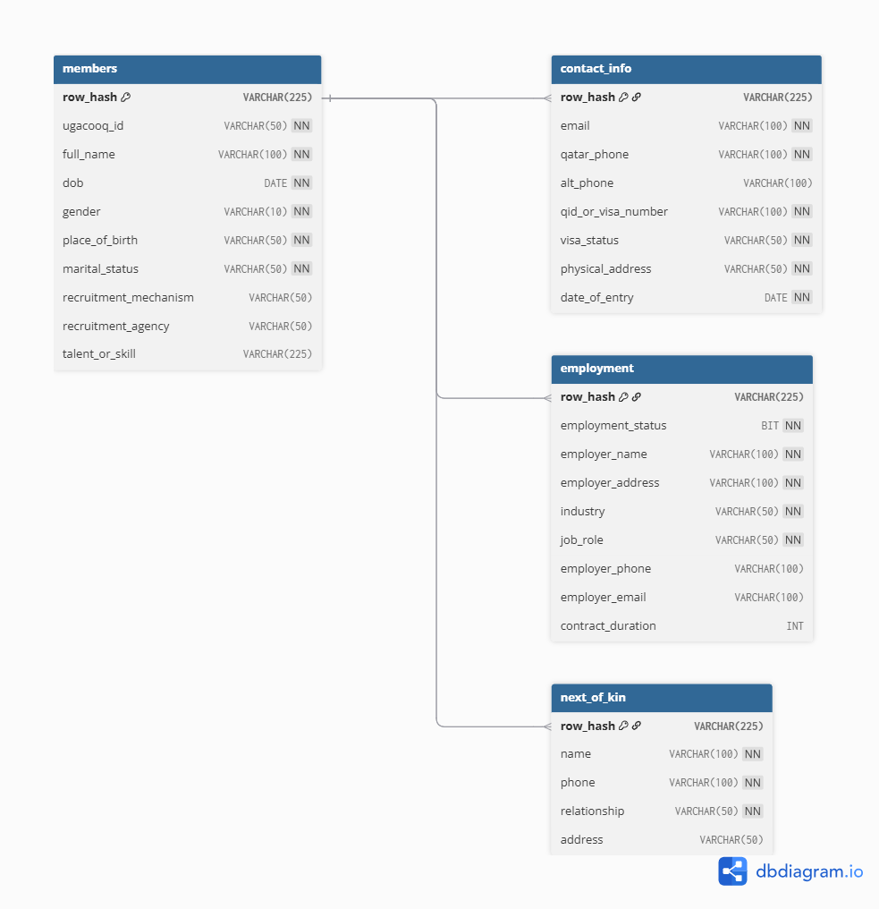

# ugacooq_data_pipeline 
Automated data pipeline for collecting, storing, and processing community member data from Google Sheets into a structured MSSQL database.

<p align="center">
  
</p>

## Project Overview
This project implements an **automated data pipeline** for managing community member registrations stored in Google Sheets. As the community grows, the Google Sheet has become increasingly difficult to maintain, leading to **duplicate entries, inconsistent contact information, and outdated records**.  

The pipeline solves these issues by ingesting raw data into a **Bronze-Silver-Gold architecture**:

- **Bronze Layer:** Stores raw data as-is for audit and traceability.  
- **Silver Layer:** Cleans, standardizes, and deduplicates records.  
- **Gold Layer:** Aggregated, analysis-ready tables that feed business intelligence tools like **Power BI**.  

This ensures a **single source of truth** for member data, enabling more accurate reporting and timely updates.


## Business Problem
Currently, the Google Sheet faces multiple operational challenges:  

- **Duplicate Registrations:** Members registering more than once with different emails or contact details.  
- **Outdated Information:** Inability to easily identify members who need to update their details.  
- **Scalability:** Manual updates are time-consuming as the number of members grows.  

Without a structured data pipeline, reporting and analytics become unreliable, slowing decision-making for community management.


## Solution & Business Impact
The pipeline enables:  

- **Accurate member tracking:** Deduplication and standardization of member records.  
- **Updated reporting:** Power BI dashboards fed by clean and aggregated data.  
- **Automation:** Reduces manual intervention and errors in data handling.  
- **Scalable architecture:** Ready to handle increasing volume of registrations and updates.  

This approach ensures community management has **reliable, actionable insights**, allowing for better decision-making and improved member engagement.


## Project Architecture
The data pipeline is designed with a three-layer architecture (Bronze, Silver, Gold) to ensure data quality, traceability, and scalability.

```
[Google Sheets] -> [Python Script (Jupyter Notebook)] -> [MSSQL Bronze Layer] -> [SQL Scripts] -> [MSSQL Silver Layer] -> [Power BI]
```

-   **Data Source:** Google Sheets containing raw community member registration data.
-   **Ingestion:** A Python script (`02_gsheet_extraction_to_bronze_table.ipynb`) extracts data from Google Sheets and loads it into the Bronze layer.
-   **Bronze Layer:** Raw, unaltered data is stored in the `bronze.ugacooq_members` table. This layer serves as a historical archive and allows for reprocessing if needed.
-   **Silver Layer:** SQL scripts (`04_payload_extraction_and _load_to_silver_stg_table.sql` and `05_silver_table_creation.sql`) clean, standardize, and deduplicate the data, loading it into the `silver.ugacooq_members` table. This layer provides a single source of truth for member data.
-   **Gold Layer:** This layer is intended for aggregated, analysis-ready tables that will feed into business intelligence tools. (Currently under development).
-   **Business Intelligence:** Power BI connects to the Silver (and eventually Gold) layer to create dashboards and reports for community management.

## Data Flow
The data flows through the pipeline in the following sequence:

1.  **Extraction:** The process begins with extracting raw data from the designated Google Sheet using a Python script.
2.  **Load to Bronze:** The extracted data is loaded into the `bronze.ugacooq_members` table in the MSSQL database without any transformations.
3.  **Staging and Cleaning:** An SQL script extracts the relevant columns from the Bronze table, unnests the JSON payload, and loads the data into a staging table in the Silver layer. During this step, data types are standardized, and initial cleaning is performed.
4.  **Load to Silver:** Another SQL script moves the cleaned data from the staging table to the final `silver.ugacooq_members` table, where duplicates are removed, and data is conformed to a consistent schema.
5.  **Reporting:** Power BI connects to the `silver.ugacooq_members` table to visualize the data and provide insights.


## Tools & Technologies
- **Python**: Google Sheets API integration and data ingestion  
- **MSSQL Server**: Bronze, Silver, Gold schemas  
- **SSIS**: ETL automation for pipeline scheduling  
- **Power BI**: Dashboarding and reporting  
- **GitHub**: Version control and Agile project management  


## Database Schema
The database is structured into three schemas: `bronze`, `silver`, and `gold`.

### Bronze Schema
The Bronze schema contains the raw, unaltered data ingested from the Google Sheet.

-   **`bronze.ugacooq_raw`**: Stores the raw data from Google Sheets.
    -   `id`: Primary key.
    -   `ingested_at`: Timestamp of when the data was ingested.
    -   `source_sheet`: Name of the source Google Sheet.
    -   `source_row`: Row number from the source Google Sheet.
    -   `payload`: JSON object containing the raw data from the row.
    -   `row_hash`: SHA256 hash of the row data, used for duplicate detection.
    -   `ingest_batch_id`: Unique identifier for the ingestion batch.

### Silver Schema
The Silver schema contains cleaned, standardized, and deduplicated data.


  


### Gold Schema
The Gold schema is designed for aggregated, analysis-ready tables that will feed into business intelligence tools. This schema is currently under development.


## Agile Management
The project follows **Scrum methodology**, with tasks tracked using **GitHub Project boards**. Each sprint delivers a small, testable increment, allowing continuous feedback and iterative improvement.


## Setup and Installation

### Prerequisites
-   Python 3.x
-   MSSQL Server
-   Access to the Google Sheet containing the community member data

### Installation
1.  **Clone the repository:**
    ```bash
    git clone https://github.com/your-username/ugacooq_data_pipeline.git
    cd ugacooq_data_pipeline
    ```

2.  **Install Python dependencies:**
    ```bash
    pip install gspread oauth2client pandas
    ```

3.  **Set up the database:**
    -   Create a new database in MSSQL Server named `UGACOOQDB`.
    -   Run the `01_schemas_and_bronze_table_creation.sql` script to create the necessary schemas and tables.

4.  **Configure environment variables:**
    -   `UGASHEET_CRED_PATH`: Path to your Google Sheets API credentials JSON file.
    -   `UGASHEET_KEY`: The key of the Google Sheet you want to access.
    -   `UGASHEET_NAME`: The name of the worksheet you want to access (defaults to "atendees").
    -   `DB_URL`: The connection string for your MSSQL database.


## Usage
To run the data pipeline, execute the following scripts in order:

1.  **`02_gsheet_extraction_to_bronze_table.ipynb`**: This Jupyter Notebook extracts data from the Google Sheet and loads it into the `bronze.ugacooq_raw` table.
2.  **`04_payload_extraction_and _load_to_silver_stg_table.sql`**: This SQL script unnests the JSON payload from the bronze table and loads the data into a staging table in the silver schema.
3.  **`05_silver_table_creation.sql`**: This SQL script creates the the silver layer tables.


## License
This project is licensed under the MIT License. See the [LICENSE](LICENSE) file for details.


## Contributing
Contributions are welcome! Please follow these steps to contribute:

1.  Fork the repository.
2.  Create a new branch (`git checkout -b feature/your-feature-name`).
3.  Make your changes.
4.  Commit your changes (`git commit -m 'Add some feature'`).
5.  Push to the branch (`git push origin feature/your-feature-name`).
6.  Open a pull request.
